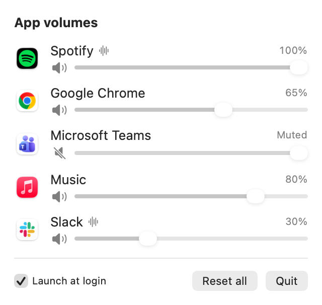

# TinyMixer

A tiny macOS menu bar app to set the volume of each app separately — turn Slack down without touching everything else.



## Build & run

Requires macOS 14.2+ and the Xcode Command Line Tools.

```sh
./build.sh && open build/TinyMixer.app
```

On first use macOS asks for **System Audio Recording** permission: it is needed to reroute an app's sound, nothing is recorded.

## How it works

For each app set below 100%, TinyMixer creates a Core Audio process tap that mutes the app's own output and plays the tapped audio back at the chosen volume. Apps at 100% are left untouched, volumes are remembered per app, and if TinyMixer quits every app's sound goes back to normal.
